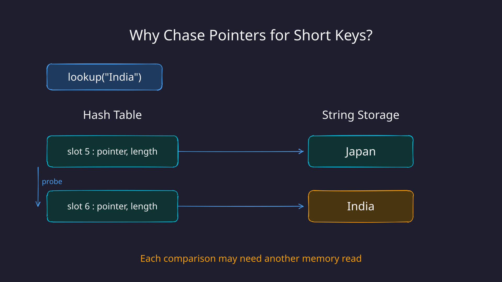
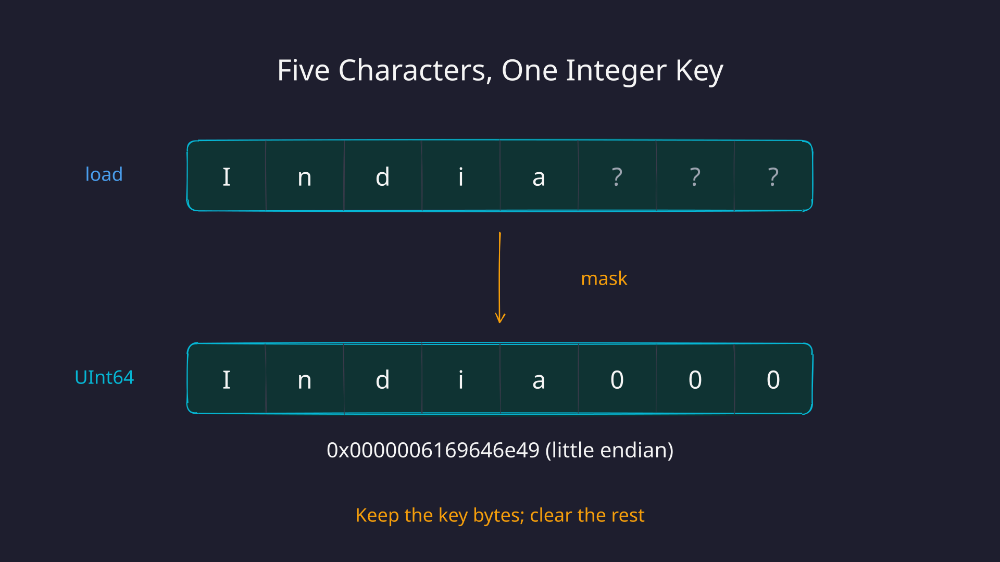
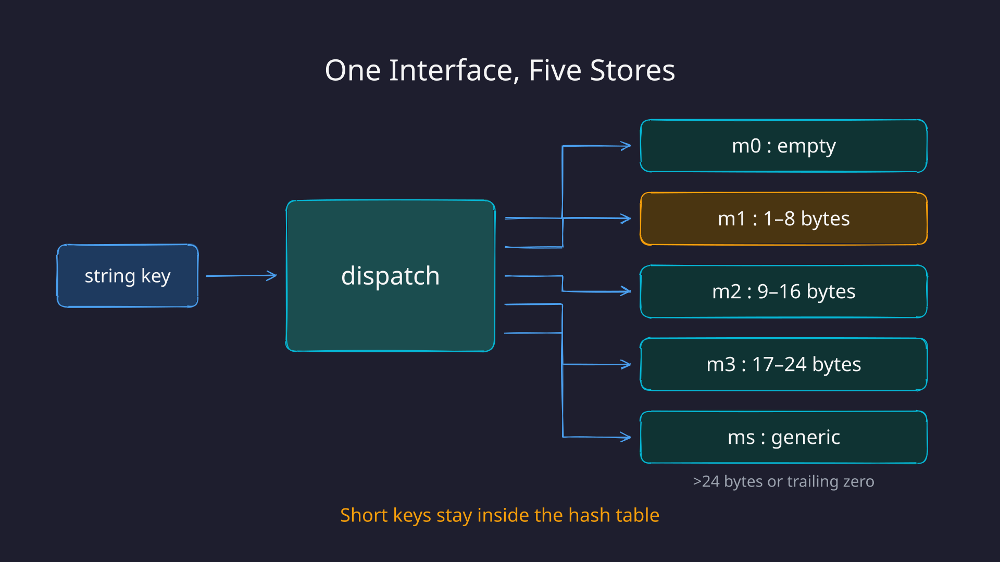
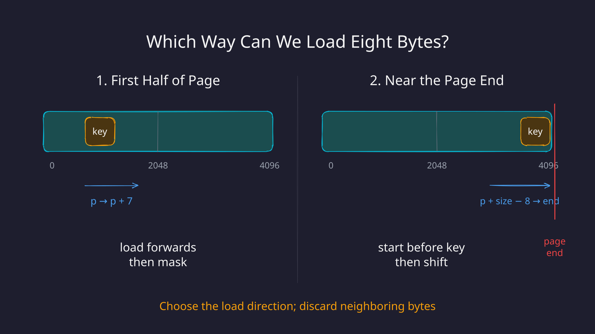

When we run a `GROUP BY` query on a string column, ClickHouse has a hash table that tries to treat the strings as integers. Why?

Because short strings can fit directly inside a hash-table slot. We can hash and compare them as integers, without following a pointer to the string's bytes somewhere else in memory.

This design comes from [SAHA: A String Adaptive Hash Table for Analytical Databases](https://www.mdpi.com/2076-3417/10/6/1915). The paper reports improvements of up to five times over the hash tables it evaluated. Those are hash-table benchmark results, rather than a promise that every `GROUP BY` query becomes five times faster.

Let's build up the idea, then find it in the ClickHouse source. We'll also cover the memory-safety detail I skipped in the video: how can we read eight bytes when a string only contains five?

Prefer video? Here's the same walkthrough:



---

### Why string keys make hash tables work harder

Consider this query:

```sql
SELECT country, count()
FROM visits
GROUP BY country;
```

Conceptually, the aggregation hash table holds the country as its key and the count as its value.

The slots in a hash table have a fixed size, but strings can be arbitrarily long. One common representation is a pointer and a length in the slot, with the actual bytes stored elsewhere. ClickHouse's generic string-key representation uses a `std::string_view` like this.

Say we're looking up `India`, and its hash sends us to slot 5. We inspect the slot, follow the pointer, and find the bytes for `Japan`. The key doesn't match, so we probe another slot and potentially follow another pointer.

{fig-alt="Looking up India: slot 5 points to Japan in separate string storage; slot 6 points to India. Both comparisons require following a pointer."}

The table's slots are close together, but the strings they point to may be in different cache lines. When a comparison needs those bytes, it can cause another cache miss. Length checks and saved hashes can avoid some comparisons, but the indirection is still there when we need to inspect a string.

Many useful grouping keys are short: country codes, status labels, and names like `India`. So why follow a pointer when the bytes would fit inside the slot itself?

---

### Two tables and a dispatcher

At a high level, we could start with two implementations:

1. An optimized table for short strings, say eight bytes or fewer, storing the bytes directly in each slot.
2. A fallback table for longer strings, storing a pointer and a length.

A dispatcher receives an operation, checks the key's length, and forwards it to the appropriate table. The caller still sees one hash-table interface.

The long-string table is familiar. The interesting question is how we represent a short key.

#### Doesn't C++ already have small string optimization?

It does. With **small string optimization**, or SSO, a `std::string` can keep short strings inside the string object instead of allocating a separate buffer.

But the object still carries metadata. Common implementations make a `std::string` object 24 or 32 bytes, depending on the standard library and ABI. That size applies whether the object lives on the stack, on the heap, or inside a hash-table slot.

If our key only needs eight bytes, that's a lot of space per aggregation bucket. Across millions of buckets, larger cells also mean fewer keys fit in a cache line.

Instead, we can store those eight bytes as a plain `UInt64`:

```text
string bytes:  I  n  d  i  a
stored bytes:  I  n  d  i  a  0  0  0
```

On a little-endian machine, that integer is `0x0000006169646e49`. We're preserving the character bytes, rather than parsing the text as a decimal number or replacing it with a hash.

This gives us three useful properties:

1. **Compact keys.** The key occupies eight bytes, excluding the count or other mapped value stored alongside it.
2. **Fixed-size comparisons.** We can compare the packed keys as integers. A string comparison can also use wide loads, but it has to handle a variable length.
3. **Cheap hashing.** We can feed the packed word directly to a hash function designed for fixed-size input.

The integer is the key itself. A separate hash chooses the table slot, and collisions are still resolved by comparing keys.

---

### Loading five bytes as eight

How do we turn `India` into that integer?

The straightforward, portable way is to initialize an integer to zero, then copy the string's bytes into it:

```cpp
// For a key of at most eight bytes.
uint64_t key = 0;
memcpy(&key, data, size);
```

For `India`, this copies five bytes and leaves three zero bytes. It is safe for an ordinary five-byte buffer.

The difficulty is that `size` varies at runtime. Depending on the compiler and target, a variable-length copy can need several loads or branches to handle the different lengths. The CPU can copy five bytes; the point is to give it a simpler, fixed-size operation in this very hot path.

ClickHouse instead loads a full eight-byte word, then removes the bytes that don't belong to the key. A fixed eight-byte `memcpy` can compile to a single unaligned load on x86-64.

{fig-alt="India is loaded together with three neighboring bytes. Masking removes the neighboring bytes, leaving I n d i a followed by three zero bytes, an eight-byte integer key."}

This reduces the work inside each size class. There are still branches for dispatching and for choosing a safe load direction. It doesn't make the entire operation branch-free.

And we can't just read past a buffer because we plan to throw those bytes away. We'll return to that when we reach the load in the source.

---

### In the source code

[ClickHouse](https://github.com/ClickHouse/ClickHouse) is an open-source OLAP database with a framework of specialized hash tables. Its [hash-table design post](https://clickhouse.com/blog/hash-tables-in-clickhouse-and-zero-cost-abstractions) gives a broader tour. Here, we'll focus on the string-adaptive table.

The code below is from [v26.2.1.1139-stable](https://github.com/ClickHouse/ClickHouse/tree/v26.2.1.1139-stable/src/Common/HashTable). ClickHouse has several aggregation paths; this is the string hash-table implementation we're exploring, rather than a claim that every string grouping uses this exact path.

#### Five stores behind one interface

In [`StringHashTable.h`](https://github.com/ClickHouse/ClickHouse/blob/v26.2.1.1139-stable/src/Common/HashTable/StringHashTable.h#L252-L256), the `StringHashTable` class contains:

```cpp
T0 m0;
T1 m1;
T2 m2;
T3 m3;
Ts ms;
```

We started with two tables. ClickHouse takes the idea further:

| Store | Keys | Representation |
|---|---|---|
| `m0` | Empty string | A dedicated cell |
| `m1` | 1–8 bytes | One `UInt64` |
| `m2` | 9–16 bytes | A `UInt128`, made of two 64-bit words |
| `m3` | 17–24 bytes | A struct of three `UInt64` words |
| `ms` | 25 bytes or more, **or any nonempty key ending in a zero byte** | `std::string_view` with a saved hash |

The concrete map types are wired together in [`StringHashMap.h`](https://github.com/ClickHouse/ClickHouse/blob/v26.2.1.1139-stable/src/Common/HashTable/StringHashMap.h#L74-L85). The nonempty subtables grow independently, so inserting a key in `m1` doesn't require resizing all the others.

{fig-alt="A string key enters the dispatcher, which chooses m0 for an empty key, m1 for 1–8 bytes, m2 for 9–16 bytes, m3 for 17–24 bytes, or ms for longer keys. Keys ending in a zero byte also go to ms."}

#### The dispatcher

[`dispatch`](https://github.com/ClickHouse/ClickHouse/blob/v26.2.1.1139-stable/src/Common/HashTable/StringHashTable.h#L295-L334) receives the key and a callable describing the operation to perform. First, it handles two special cases:

```cpp
const auto & x = keyHolderGetKey(key_holder);
const size_t sz = x.size();
if (sz == 0)
{
    keyHolderDiscardKey(key_holder);
    return func(self.m0, VoidKey{}, 0);
}

if (x[sz - 1] == 0)
{
    return func(self.ms, std::forward<KeyHolder>(key_holder), hash(x));
}
```

Why route strings ending in zero to the generic table?

Because our packed representation doesn't store an explicit length. `India` and `India\0` would produce the same eight-byte value after zero padding. To distinguish them, the latter must use `ms`, which retains the length. This also lets ClickHouse reconstruct a packed key's length by counting zero bytes at the end of the word. Embedded zero bytes are fine; the last byte of a packed key must be nonzero.

Next comes the size dispatch:

```cpp
const char * p = x.data();
const char s = (-sz & 7) * 8;

switch ((sz - 1) >> 3)
{
    case 0: // 1..8 bytes
        // Pack into k8 and call func(self.m1, k8, hash(k8)).
    case 1: // 9..16 bytes
        // Pack into k16 and call func(self.m2, k16, hash(k16)).
    case 2: // 17..24 bytes
        // Pack into k24 and call func(self.m3, k24, hash(k24)).
    default: // >= 25 bytes
        // Forward the string key to ms.
}
```

This is an outline of the switch; each real case returns after calling the operation.

`(sz - 1) >> 3` groups lengths into eight-byte ranges. `s` is the number of bits to clear or shift away in the final word. For five bytes, `s` is 24. For eight bytes, it's zero.

#### The memory-safety detail: where do we load from?

Here's the part I left out of the video. In the [1–8 byte case](https://github.com/ClickHouse/ClickHouse/blob/v26.2.1.1139-stable/src/Common/HashTable/StringHashTable.h#L335-L356), the little-endian path is equivalent to this:

```cpp
// Simplified: little-endian path only.
uint64_t packed;
if ((reinterpret_cast<uintptr_t>(p) & 2048) == 0)
{
    memcpy(&packed, p, 8);
    packed &= -1ULL >> s;
}
else
{
    const char * load_start = p + sz - 8;
    memcpy(&packed, load_start, 8);
    packed >>= s;
}
```

There are two separate issues here: staying within readable memory pages, and satisfying the buffer's allocation contract.

**First, the page boundary.** Imagine a five-byte string at the very end of a readable page. Loading eight bytes from its first character would also read three bytes from the next page. If that page is inaccessible, the load faults. Masking the result afterwards cannot fix that.

The `& 2048` test checks address bit 11. To see why it works, consider a 4096-byte page:

- If `p` is in the first half, its offset is 0–2047. Reading eight bytes forwards cannot reach the page's end. ClickHouse loads from `p`, then masks away the unwanted high bytes on a little-endian machine.
- If `p` is in the second half, ClickHouse loads from `p + sz - 8`. For a five-byte key, that's three bytes **before** `p`. The load ends exactly at the string's end, and starting at most seven bytes earlier cannot cross the page's beginning.

{fig-alt="Two views of a 4096-byte page. In the first half, ClickHouse can load forwards from a short key. Near the page end, it starts the eight-byte load before the key so that it ends at the key's end and avoids the inaccessible next page."}

For our five-byte key, the backward load looks like this:

```text
loaded bytes:   ?  ?  ?  I  n  d  i  a
shift right 24: I  n  d  i  a  0  0  0
```

Both directions produce the same packed integer. The question marks are neighboring bytes, not part of the key. The code also handles big-endian machines, reversing the direction of the mask or shift.

The bit test is a cheap way to choose the load direction. It doesn't call the OS to discover the page size. The 4 KiB example explains the relevant boundary; the reasoning also applies within larger aligned pages whose boundaries are multiples of 4 KiB.

**Second, the buffer contract.** Being on a readable page doesn't by itself make an out-of-bounds C++ access valid. The source explicitly says that the dispatcher requires keys padded for eight-byte reads, and that an arbitrary `std::string` must not be passed here. A `std::string_view` only describes a pointer and a length; it doesn't establish that surrounding bytes may be read.

One supported source is [`ColumnString::getDataAt()`](https://github.com/ClickHouse/ClickHouse/blob/v26.2.1.1139-stable/src/Columns/ColumnString.h#L121-L125). The column stores its string bytes in a `PaddedPODArray`, whose [definition reserves padding on both sides](https://github.com/ClickHouse/ClickHouse/blob/v26.2.1.1139-stable/src/Common/PODArray_fwd.h#L24-L26). A short key's surrounding bytes can belong to neighboring strings or to that allocation's padding. The mask or shift removes them from the result.

So the page check explains the load direction, while the caller's memory layout supplies the readable bytes around the key. This is an optimization built for ClickHouse's controlled buffers. For a standalone buffer with only `size` readable bytes, the zero-initialized, exact-length `memcpy` from earlier is the appropriate version.

**What about 9–24 bytes?** Those keys are long enough to load the first complete word, or first two complete words, entirely within the string. The final load starts at `p + sz - 8`, so it also stays inside the string, overlapping the earlier load if necessary.

For example, for the ten-byte key `abcdefghij`:

```text
first load:    a b c d e f g h
last load:        c d e f g h i j

first word:    a b c d e f g h
second word:   i j 0 0 0 0 0 0    (after shifting right by 48 bits)
```

This is how ClickHouse uses full-word loads without needing a separate tiny copy for every possible remainder length.

#### Hashing the packed key

Once the dispatcher has produced `k8`, it invokes:

```cpp
return func(self.m1, k8, hash(k8));
```

The hash implementation is [`StringHashTableHash`](https://github.com/ClickHouse/ClickHouse/blob/v26.2.1.1139-stable/src/Common/HashTable/StringHashTable.h#L49-L75), near the top of the same file. For an x86 build with SSE4.2 enabled, the eight-byte overload is:

```cpp
size_t ALWAYS_INLINE operator()(StringKey8 key) const
{
    size_t res = -1ULL;
    res = _mm_crc32_u64(res, key);
    return res;
}
```

`_mm_crc32_u64` uses the CPU's CRC instruction to update a CRC-32C accumulator with a 64-bit word. The starting value here is all ones. Although the intrinsic accepts a 64-bit operand, the CRC result is 32 bits.

The 16-byte overload chains two CRC instructions, and the 24-byte overload chains three. The file also has an ARM CRC path and other architecture-specific handling; when none of those paths is available, it uses CityHash for the packed keys. The generic string overload delegates to `StringViewHash`.

CRC-32C is a fast checksum that ClickHouse uses as a hash here. Its collisions don't merge different countries into one group: the table still compares the complete packed keys. Hash quality affects probing cost, while key equality determines whether two entries belong to the same group.

#### The operations share the same dispatcher

Finally, [`emplace` and `find`](https://github.com/ClickHouse/ClickHouse/blob/v26.2.1.1139-stable/src/Common/HashTable/StringHashTable.h#L389-L435) both go through `dispatch`:

```cpp
// Insert, or find an existing key.
this->dispatch(*this, key_holder, EmplaceCallable(it, inserted));

// Look up a key.
return dispatch(*this, x, FindCallable{});
```

The callable invokes the operation on whichever subtable the dispatcher chooses. That means insertion and lookup use the same representation and hash for a given key.

I find this separation pretty neat. The short-key tables don't need to know how a string was loaded or padded. They receive a fixed-size integer key, its hash, and an operation.

---

### Summary

String keys can make a hash table follow pointers and inspect bytes outside its own slots. For short strings, ClickHouse avoids that by packing the bytes into one, two, or three 64-bit words and storing them directly in the table.

A dispatcher chooses the representation. Empty strings have their own cell, longer strings retain a pointer and a saved hash, and strings ending in a zero byte take the generic path so that their length is preserved.

The full-word loads are part of the same design: choose a load direction, remove neighboring bytes, then hash and compare the resulting integers. Making this work depends on both the key representation and the memory layout of the buffers supplying it.

---

### Credits and Resources

I used Codex to help adapt the video script and check the implementation against the source. The main resources are:

1. [SAHA: A String Adaptive Hash Table for Analytical Databases](https://www.mdpi.com/2076-3417/10/6/1915), Tianqi Zheng, Zhibin Zhang, and Xueqi Cheng.
2. [ClickHouse source: `StringHashTable.h`](https://github.com/ClickHouse/ClickHouse/blob/v26.2.1.1139-stable/src/Common/HashTable/StringHashTable.h) and [`StringHashMap.h`](https://github.com/ClickHouse/ClickHouse/blob/v26.2.1.1139-stable/src/Common/HashTable/StringHashMap.h), v26.2.1.1139-stable.
3. [Hash tables in ClickHouse and C++ Zero-cost Abstractions](https://clickhouse.com/blog/hash-tables-in-clickhouse-and-zero-cost-abstractions), ClickHouse.

---
